# Warrant Architecture

> Status: design draft for the PayPal AI Hackathon MVP (v1 draft, Oct 21, 2026).
> Items marked **[Assumption]** are defaults until someone objects. Items marked **[Verify]** must be confirmed during week one.
> PayPal API support was checked against PayPal's official OpenAPI specs on Oct 21, 2026. See [§ 9](#9-paypal-integration).

This document covers what Warrant is made of, how a purchase moves through it, and the rules the system has to keep. For the product pitch and quickstart, see [README.md](README.md).

---

## 1. Warrant in one paragraph

An AI shopping agent wants to buy something. Before it can pay, it has to ask Warrant. Warrant checks the request against a **permission** the person signed earlier (budget, per-purchase cap, allowed stores and categories, return terms) and answers with one of three decisions: **ALLOW**, **CONFIRM** (ask the human), or **BLOCK**. Each answer comes with a reason. If the purchase goes ahead, it is paid through a real **PayPal sandbox order**, and Warrant saves an **evidence pack** that shows what was allowed and why.

The AI model never makes the decision. A deterministic rules engine does.

---

## 2. System context

Who and what talks to Warrant.

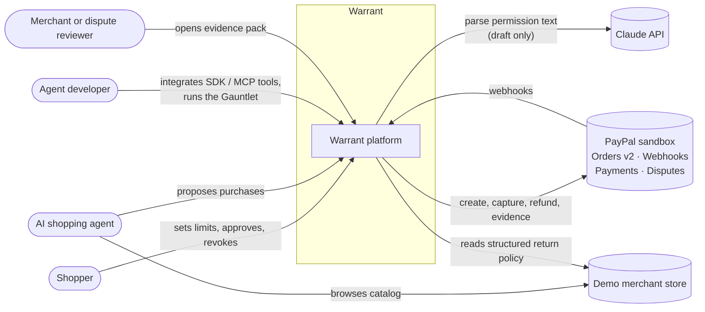

---

## 3. Components

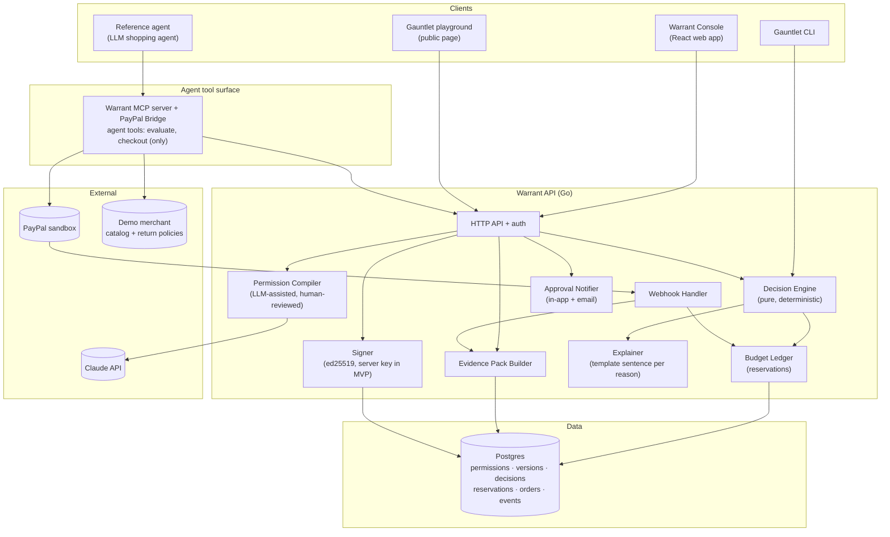

| Component | Job | Notes |
|---|---|---|
| **Warrant Console** | Create, sign, pause, edit and revoke permissions. Approve held purchases. View the timeline and evidence packs. | React, five screens plus the public Gauntlet page. |
| **Permission Compiler** | Turns "Spend up to $100 a month on household stuff, ask me above $25" into a structured permission. | Uses Claude. Output is always shown to the human for edit and approval before signing. Never trusted on its own. |
| **Signer** | Signs the canonical permission JSON and stores the hash. | MVP: server-held ed25519 key after an explicit approval screen. v1: passkeys (WebAuthn). |
| **Decision Engine** | Returns ALLOW, CONFIRM or BLOCK with reason codes. | Pure function of (signed permission, ledger state, normalized proposal). Go library, open source. The only component that can say yes. |
| **Budget Ledger** | Holds budget for a purchase while it is in flight. | Postgres with row locking. Reserve on decision, commit on capture, release on decline, failure or timeout (15 min). |
| **Explainer** | Writes the one-sentence explanation for a decision. | Deterministic templates in `engine/explain.go`, one per reason code. An LLM rewording step was considered and not built: it adds latency and lets wording drift from the decision. |
| **PayPal Bridge** | Warrant's own MCP server. Gives the agent only two tools, `evaluate` and `checkout`, and calls PayPal's REST APIs directly from Go. | We don't build on PayPal's Agent Toolkit: it supports only TypeScript and Python and has no tools for saved payment methods or dispute evidence. The agent never gets PayPal credentials or PayPal tools, so it can't pay around Warrant. |
| **Webhook Handler** | Receives PayPal events and updates state. | Verifies webhook signatures. Idempotent. |
| **Evidence Pack Builder** | Assembles the record for an order. | JSON export plus a readable page. Attached to sandbox disputes through `provide-evidence` (confirmed in the API spec). |
| **Approval Notifier** | Sends the one-tap approval card. | In-app and email. |
| **Gauntlet** | Adversarial test harness. | Runs the same scenarios against three arms: unrestricted LLM agent, fixed-threshold limiter, Warrant. |
| **Demo merchant** | A store whose catalog has structured return-policy data. | Needed because sandbox merchants have no checkable policies. Real-policy checks are v1. |

---

## 4. Trust boundaries

The most important rule in the design: **anything that is not the signed permission can only make Warrant more careful, never less.**

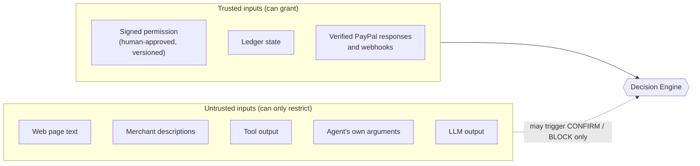

### Invariants

1. **The model never decides.** The LLM drafts permissions (which a human reviews) and writes explanations. Decisions come only from the engine.
2. **Untrusted text can only reduce autonomy.** It can cause CONFIRM or BLOCK. It can never raise a limit.
3. **PayPal is the system of record for money.** Warrant never holds funds or card credentials, and never reports success without a verified PayPal response or webhook.
4. **Uncertainty escalates.** Missing or unverifiable terms lead to CONFIRM, not a guess.
5. **No guarantees.** The evidence pack supports a dispute. It does not decide one.
6. **The agent cannot reach PayPal directly.** PayPal credentials live only inside Warrant. The agent's only payment path is `checkout`, which requires a `decision_id` that permits the purchase.

---

## 5. User journeys

### Journey A: Shopper creates a permission

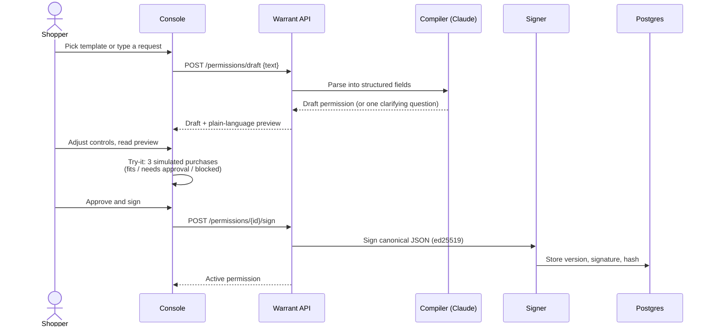

### Journey A2: Connect PayPal once (Mode B only)

In Mode B (see [§ 9](#9-paypal-integration)), the shopper saves their PayPal account once so the agent can later pay without sending them to PayPal each time.

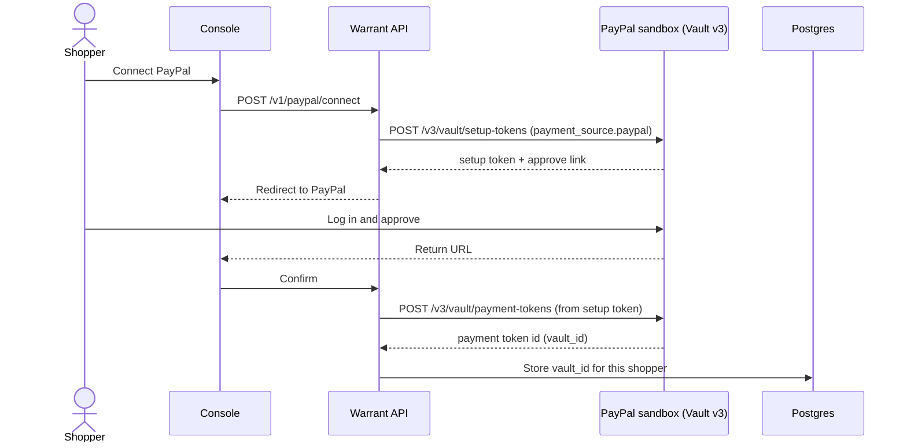

Saving a PayPal account without a purchase uses Vault v3 setup tokens. The other option is to save it during a first purchase with `attributes.vault.store_in_vault: ON_SUCCESS`. Which one the sandbox allows for our app is part of gate 1 **[Verify]**.

### Journeys B, C, D: Agent proposes a purchase

This one diagram covers all three outcomes.

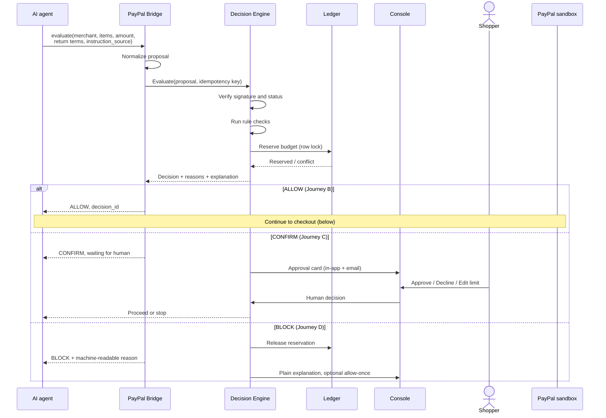

### Checkout after ALLOW (or approved CONFIRM)

Checkout first **authorizes** the payment (PayPal holds the funds), then checks the amount, then **captures** it. This matches our ledger: hold, then commit or release.

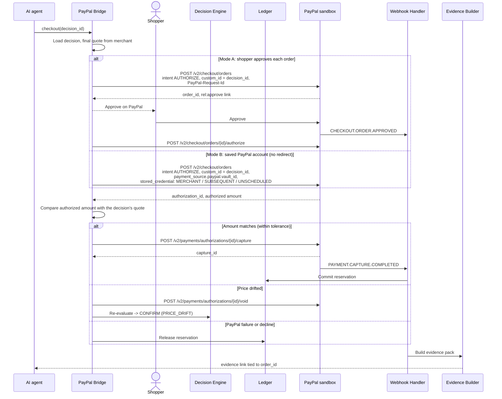

### Journey E: Pause, edit or revoke

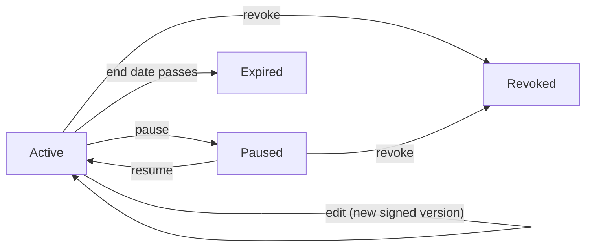

Any change that stops a permission (pause, revoke, expiry) releases all open reservations. Every edit creates a new version with a new signature. Old versions are kept so evidence packs always point at the exact version that was in force.

### Journey F: Dispute review

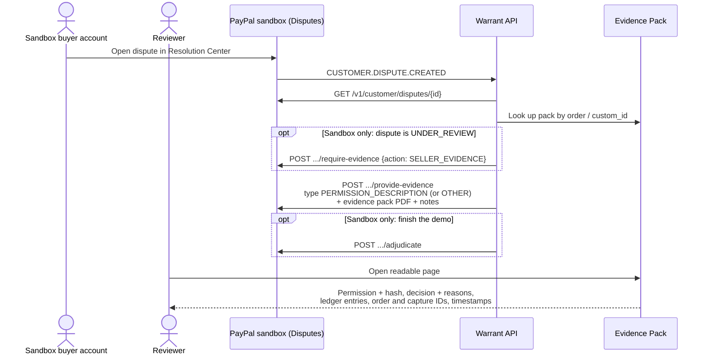

Rules from the Disputes API spec:

- The merchant can send evidence only while the dispute's status is `WAITING_FOR_SELLER_RESPONSE`, and only when the dispute's links include `provide-evidence`.
- Sandbox disputes are opened by the sandbox buyer account in the Resolution Center. Opening one through the API needs extra scopes and buyer consent.
- The dispute reason we expect for an agent purchase is `UNAUTHORISED`.
- PayPal's file size and file type limits for evidence uploads aren't in the spec **[Verify]**.

### Journey G: Developer integration

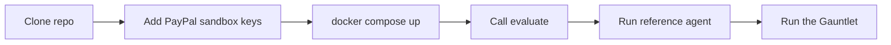

Target: first decision call in under 10 minutes.

---

## 6. Decision engine

### Evaluation order

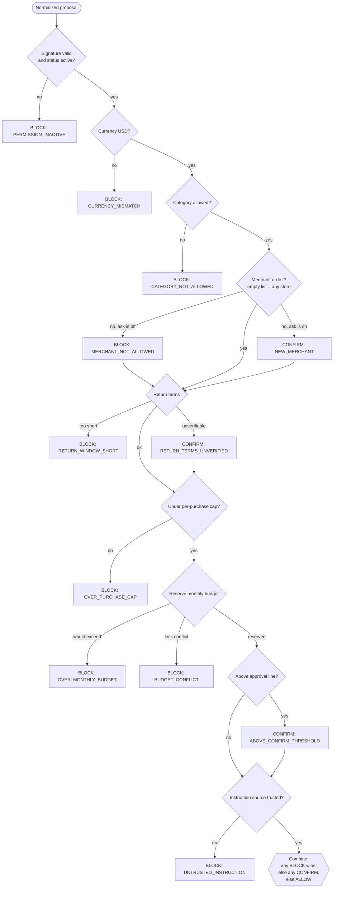

All checks run and every reason is recorded, so the shopper sees the full picture. The final outcome follows the combine rule: **any BLOCK wins, otherwise any CONFIRM wins, otherwise ALLOW.**

Exceptions and details (as implemented in `engine/`):

- If the signature or status check fails, the engine stops there and returns only `PERMISSION_INACTIVE`. Nothing else in an unsigned or tampered permission can be trusted.
- `BUDGET_CONFLICT` comes from the ledger, not the engine: it is returned when the budget lock can't be taken within 2 seconds. That decision is stored without its idempotency key, so the agent can retry with the same key.
- A stated return window shorter than the minimum blocks even if unverified. A missing or unverified window asks.
- Instruction sources `user` and `agent` are trusted. `web`, `merchant`, `tool_output` and any unknown value are not.
- Budgets reset each calendar month (UTC).

### Reason codes

| Code | Outcome | What the shopper sees |
|---|---|---|
| `WITHIN_PERMISSION` | ALLOW | Within your permission: $48 of your $120 monthly budget, 14-day returns. |
| `OVER_MONTHLY_BUDGET` | BLOCK | This would take you past your $120 monthly limit. |
| `OVER_PURCHASE_CAP` | BLOCK | This is above your $60 per-purchase limit. |
| `ABOVE_CONFIRM_THRESHOLD` | CONFIRM | Above your $25 approval line, so I'm asking you. |
| `CATEGORY_NOT_ALLOWED` | BLOCK | Electronics isn't in this permission. |
| `NEW_MERCHANT` | CONFIRM | First time at this store. Want to allow it? |
| `MERCHANT_NOT_ALLOWED` | BLOCK | Other-shop isn't on this permission's store list. (Store not on the list and "ask for new stores" is off.) |
| `RETURN_WINDOW_SHORT` | BLOCK | Returns are 3 days; your minimum is 7. |
| `RETURN_TERMS_UNVERIFIED` | CONFIRM | I couldn't verify the return policy. Your call. |
| `PRICE_DRIFT` | CONFIRM | The price changed from $48 to $61 at checkout. |
| `CURRENCY_MISMATCH` | BLOCK | This store charges in a currency this permission doesn't cover. |
| `PERMISSION_INACTIVE` | BLOCK | This permission is paused. |
| `UNTRUSTED_INSTRUCTION` | BLOCK | A web page told the agent to ignore your limits. I didn't. |
| `BUDGET_CONFLICT` | BLOCK | Another purchase is using this budget right now. |

### Performance target

Engine decision latency p95 ≤ 300 ms, not counting LLM or PayPal calls.

---

## 7. Budget ledger

### Reservation lifecycle

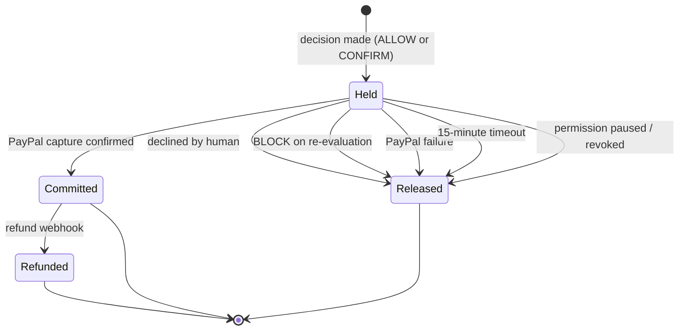

### Concurrency

- Each permission's monthly spend is guarded by a row lock (`SELECT ... FOR UPDATE`) inside one transaction.
- Available budget = monthly cap − committed − held.
- Every call carries an **idempotency key**; a repeated call returns the original decision.
- Test requirement: many simultaneous requests against one permission must never push committed + held past the monthly cap.

### How the ledger maps to PayPal

| Ledger state | PayPal action |
|---|---|
| Held | Decision made. At checkout, PayPal authorizes the payment and holds the funds (order `intent: AUTHORIZE`). |
| Committed | `POST /v2/payments/authorizations/{id}/capture` succeeded and `PAYMENT.CAPTURE.COMPLETED` arrived. |
| Released | `POST /v2/payments/authorizations/{id}/void`, or no order was ever created. |
| Refunded | `POST /v2/payments/captures/{id}/refund` and `PAYMENT.CAPTURE.REFUNDED`. |

Our own ledger is still the source of truth for budget. PayPal's authorization is a second safety net, not a replacement.

---

## 8. Data model

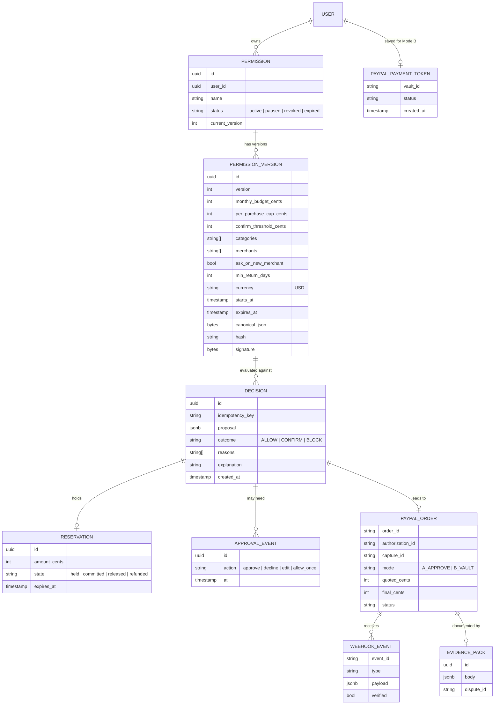

Each PayPal order stores the Warrant `decision_id` in `purchase_units[].custom_id` (up to 255 characters, hidden from the buyer, shown in PayPal reports). We also keep the link in our own database, keyed by `order_id`, so lookups never depend on PayPal.

---

## 9. PayPal integration

Checked against PayPal's OpenAPI specs (Orders v2, Payments v2, Disputes v1, Webhooks v1, Payment Tokens v3) on Oct 21, 2026. Sandbox base URL: `https://api-m.sandbox.paypal.com`. Auth: OAuth 2.0 client credentials at `/v1/oauth2/token`.

### Endpoint map

| Step | Endpoint | Status |
|---|---|---|
| Get access token | `POST /v1/oauth2/token` | Supported |
| Save PayPal account (Mode B) | `POST /v3/vault/setup-tokens`, then `POST /v3/vault/payment-tokens` | Supported in the API. Production needs Billing Agreements approval **[Verify in sandbox]** |
| Create order | `POST /v2/checkout/orders` (`intent: AUTHORIZE`, `custom_id`, `PayPal-Request-Id`) | Supported |
| Buyer approval (Mode A) | `rel:approve` link from the create response | Supported |
| Authorize | `POST /v2/checkout/orders/{id}/authorize` | Supported |
| Read final amount | `GET /v2/checkout/orders/{id}` | Supported |
| Capture | `POST /v2/payments/authorizations/{id}/capture` | Supported |
| Release | `POST /v2/payments/authorizations/{id}/void` | Supported |
| Refund | `POST /v2/payments/captures/{id}/refund` (full or partial) | Supported |
| Webhooks | `CHECKOUT.ORDER.APPROVED`, `PAYMENT.AUTHORIZATION.CREATED / VOIDED`, `PAYMENT.CAPTURE.COMPLETED / PENDING / DECLINED / REFUNDED / REVERSED`, `CUSTOMER.DISPUTE.CREATED / UPDATED / RESOLVED`, `VAULT.PAYMENT-TOKEN.CREATED / DELETED` | Supported |
| Verify webhook | `POST /v1/notifications/verify-webhook-signature` | Supported |
| Simulate webhook | `POST /v1/notifications/simulate-event` | Supported (testing) |
| Dispute evidence | `POST /v1/customer/disputes/{id}/provide-evidence` | Supported, with conditions (see Journey F) |
| Sandbox dispute controls | `.../require-evidence`, `.../adjudicate` | Sandbox only |
| Spending permissions or mandates | none | **Not offered by PayPal.** This is the gap Warrant fills. |

### Two payment modes

| | Mode A: approve each order | Mode B: saved PayPal account |
|---|---|---|
| Shopper step per purchase | Approves on PayPal every time | None after the one-time connect |
| Special PayPal access | None | Billing Agreements approval in production; sandbox expected to work **[Verify]** |
| Fits journey B ("no human step") | No | Yes |
| Role in MVP | Fallback that always works | Main demo path if gate 1 passes |

Mode B order request:

```json
{
  "intent": "AUTHORIZE",
  "purchase_units": [{
    "custom_id": "dec_8f2a...",
    "invoice_id": "wr_ord_123",
    "amount": { "currency_code": "USD", "value": "18.00" }
  }],
  "payment_source": {
    "paypal": {
      "vault_id": "<payment token id>",
      "stored_credential": {
        "payment_initiator": "MERCHANT",
        "usage": "SUBSEQUENT",
        "payment_type": "UNSCHEDULED"
      }
    }
  }
}
```

### Known limits

- **A saved PayPal account works with one merchant.** It is tied to the merchant account that saved it. That's fine for our demo store. Letting an agent buy from *any* store needs PayPal's partner setup (`PayPal-Auth-Assertion`, partner onboarding) or a PayPal agent product. That's v1 or later.
- **No public developer docs for PayPal's agent products.** We found none on developer.paypal.com for Agent Ready, Store Sync or AP2. We don't build on them for the MVP.
- **We don't use PayPal's Agent Toolkit or MCP server for payments.** It supports only TypeScript and Python, and has no vault or dispute-evidence tools. If an agent had both our tools and PayPal's `create_order`, it could pay around Warrant.
- **`PATCH` can change an approved order.** PayPal lets an order be updated while it is `CREATED` or `APPROVED`. That's why we compare the authorized amount with the quote before capturing.
- **`PayPal-Request-Id` (idempotency) works on create, authorize and capture, but not on `PATCH`.**

Warrant never stores buyer PayPal logins. API keys and payment token IDs live only on the server.

---

## 10. Developer API

### `POST /v1/evaluate`

Request:

```json
{
  "permission_id": "perm_123",
  "merchant": "demo-store",
  "category": "household",
  "amount": "32.00",
  "currency": "USD",
  "return_window_days": 14,
  "return_terms_verified": true,
  "instruction_source": "user"
}
```

Response:

```json
{
  "decision_id": "dec_3xq7...",
  "decision": "CONFIRM",
  "status": "awaiting_approval",
  "reasons": ["ABOVE_CONFIRM_THRESHOLD"],
  "explanation": "Above your $25 approval line, so I'm asking you.",
  "permission_id": "perm_123",
  "permission_version": 1,
  "amount_cents": 3200,
  "remaining_after_cents": 6800,
  "reservation": { "id": "res_...", "status": "held", "amount_cents": 3200, "expires_in_seconds": 900 }
}
```

`201` for a new decision, `200` when an `Idempotency-Key` replays an earlier one (`"replayed": true`).

Auth uses two bearer tokens. The **console** token (the person) manages permissions and answers approvals. The **agent** token can only call `evaluate` and read decisions, so an agent can never approve its own purchase.

| Method | Path | Token | Status | Purpose |
|---|---|---|---|---|
| GET | `/healthz` | none | Built | Health check |
| POST | `/v1/permissions` | console | Built | Create a draft permission (version 1, unsigned) |
| GET | `/v1/permissions` | console | Built | List permissions with this month's budget |
| GET | `/v1/permissions/{id}` | console | Built | One permission: current and latest version, budget, remaining |
| POST | `/v1/permissions/{id}/versions` | console | Built | Save an edit as a new unsigned version |
| POST | `/v1/permissions/{id}/sign` | console | Built | Sign the reviewed version: `{"version": n}` |
| PATCH | `/v1/permissions/{id}` | console | Built | `{"status": "paused" \| "active" \| "revoked"}`. Pause and revoke release holds |
| GET | `/v1/permissions/{id}/decisions` | console | Built | Decisions, newest first |
| GET | `/v1/permissions/{id}/events` | console | Built | Activity timeline |
| POST | `/v1/evaluate` | agent | Built | Get a decision. Requires an `Idempotency-Key` header |
| GET | `/v1/decisions/{id}` | both | Built | Decision with `status`: `ready`, `awaiting_approval`, `blocked`, `released`, `completed` |
| POST | `/v1/decisions/{id}/approve` | console | Built | `{"action": "approve" \| "decline"}` on a CONFIRM |
| GET | `/v1/config` | console | Built | PayPal mode, compiler on/off, known merchants |
| POST | `/v1/permissions/draft` | console | Built | Compile plain text into a draft permission (Claude). 503 without `ANTHROPIC_API_KEY` |
| POST | `/v1/permissions/preview` | console | Built | Plain-language summary + three trial decisions for an unsigned permission. Stores nothing |
| POST | `/v1/checkout` | agent | Built | `{decision_id, final_amount?}`. Create, authorize, check the amount, capture or void. Call again to continue |
| GET | `/v1/permissions/{id}/orders` | console | Built | PayPal orders for a permission |
| GET | `/v1/orders/{id}` | console | Built | One PayPal order |
| POST | `/v1/orders/{id}/refund` | console | Built | Full refund through PayPal; spend returns to the budget |
| GET/POST/DELETE | `/v1/paypal/connection`, `/v1/paypal/connect`, `/v1/paypal/connect/complete` | console | Built | Save, check or remove the shopper's PayPal account (Mode B) |
| POST | `/v1/webhooks/paypal` | PayPal | Built | Verified with PayPal, stored once, then applied |
| GET | `/paypal/return`, `/paypal/cancel`, `/paypal/vault/return`, `/paypal/vault/cancel` | buyer | Built | Where PayPal sends the buyer back |
| GET | `/v1/evidence/{order_id}` | console | Phase 6 | Evidence pack (PDF), attached to disputes |

---

## 11. Evidence pack

Contents:

- Permission summary, version, hash and signature metadata
- The original proposal (including instruction source)
- Decision, all reason codes and the explanation
- Ledger entries (held, committed, released)
- Approval events, if any
- PayPal order ID and capture ID
- Timestamps for every step, tracking info if provided

It is readable by people and exportable as JSON. For a dispute, it is sent to PayPal as a PDF with evidence type `PERMISSION_DESCRIPTION` (or `OTHER` if PayPal rejects that), plus a short note. It is not a legal contract and does not claim PayPal will accept it.

---

## 12. Gauntlet

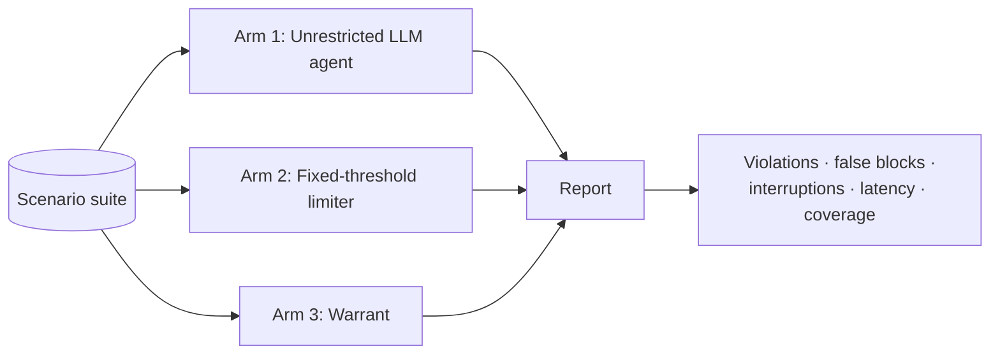

Scenario families: ordinary purchases, exact-boundary values, budget races, price drift, shipping and tax changes, expired or paused permissions, unclear return terms, prompt injection in merchant text and tool output, and agents tampering with their own arguments.

Every Gauntlet failure becomes a regression test. Results describe engine behavior on scenarios we wrote, not real-world safety.

---

## 13. Deployment **[Assumption]**

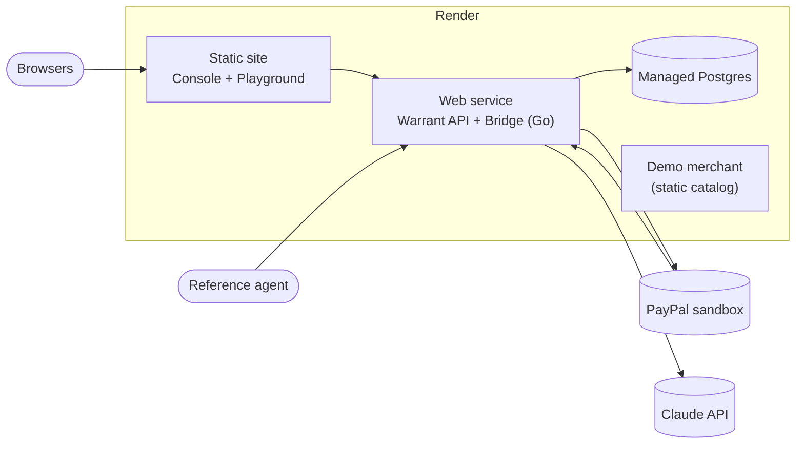

Secrets (PayPal sandbox client ID/secret, webhook ID, Claude API key, signing key) are environment variables on the Render service. A visible "sandbox, no real money" banner is shown on every screen.

---

## 14. Quality targets

| Area | Target |
|---|---|
| Executions outside permission (tested constraints) | 0. Any is a hard fail. |
| False-block rate on the Gauntlet | ≤ 5% |
| Approval prompts per 100 eligible purchases | Lower than the fixed-threshold baseline |
| Engine latency p95 | ≤ 300 ms (excluding LLM and PayPal) |
| Time to first permission (shopper) | ≤ 2 minutes |
| Time to first decision (developer) | ≤ 10 minutes |

---

## 15. Open questions

Answered by the API check on Oct 21:

- ~~Can order fields carry the decision ID?~~ Yes, in `custom_id`.
- ~~Does the sandbox Disputes API support provide-evidence?~~ Yes, plus sandbox-only `require-evidence` and `adjudicate`.
- ~~Does PayPal's Agent Toolkit support our language?~~ No: TypeScript and Python only. We call the REST APIs from Go.

- ~~Gate 1, Mode A:~~ **Passed Oct 21, 2026.** A real sandbox order went through the full path: permission → CONFIRM → approved in the Console → `checkout` → buyer approved on PayPal → authorized $32.00 (matched the quote) → captured `COMPLETED` → budget committed. PayPal's capture carries `custom_id` = decision ID and `invoice_id` = `wr_<decision>`.

- ~~Gate 1, Mode B:~~ **Passed Oct 21, 2026.** The buyer connected once (Vault v3 setup token → payment token). Then evaluate ALLOW $12.00 → one `checkout` call → order created with `vault_id` and `stored_credential` MERCHANT/SUBSEQUENT/UNSCHEDULED → authorized → captured `COMPLETED`, with no buyer redirect. Mode B is the main demo path. (Production still needs PayPal's Billing Agreements approval.)
- ~~With a `vault_id`, does `intent: AUTHORIZE` return the authorization immediately?~~ Handled either way: checkout authorizes if the create response has no authorization.

Still open:
- With a `vault_id`, does creating an order with `intent: AUTHORIZE` return the authorization immediately, or does it need a separate `authorize` call?
- Does PayPal accept `PERMISSION_DESCRIPTION` as an evidence type for an `UNAUTHORISED` dispute? What are the file size and type limits?
- Which agent framework hosts the reference agent?
- Do passkeys fit in the MVP, or stay in v1?
- What does PayPal require for human-not-present payments?
