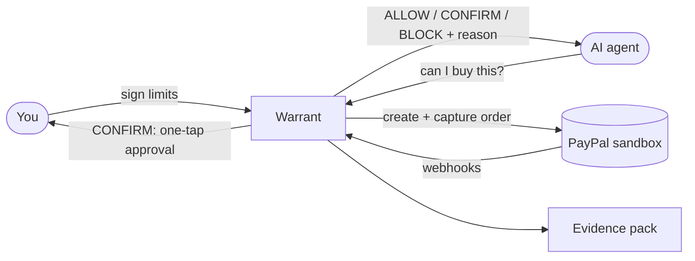

# Warrant

**Let agents shop. Keep the keys.**

Warrant is a permission and evidence layer that sits between an AI shopping agent and PayPal checkout. You set spending limits in plain language. Warrant turns them into a signed permission. Every time an agent wants to buy something, a deterministic engine decides to **allow** it, **ask you**, or **block** it, and records why. PayPal still moves the money.

> 🚧 **Status:** in development for the PayPal AI Hackathon (submissions close Nov 12, 2026). Everything runs against the **PayPal sandbox**. No real money moves.
>
> **Built:** Phases 0–5: gates, decision engine, ledger + API, PayPal sandbox checkout (both modes) + webhooks + MCP server, Claude permission compiler, and the Console. **Next:** Phase 6 (evidence pack + disputes), Phase 7 (Gauntlet, demo store, reference agent), Phase 8 (ship).

---

## Why

People already use AI to find products, but most are not comfortable letting an agent pay. The usual fix is a spend limit written inside the agent's own code, which the agent (or a malicious web page) can talk its way around, and which leaves no clear record of what was authorized.

Warrant moves that check **outside the model**:

- **Readable limits.** You can read your permission in ten seconds and revoke it in one tap.
- **Enforced limits.** An AI model never makes the buy/no-buy call. A rules engine does.
- **Manipulation-resistant.** Text from web pages, merchants or tools can only make Warrant more careful, never less.
- **Provable.** Each order gets an evidence pack: what you allowed, what was decided, and the PayPal order it led to.

---

## How it works



1. **Set a permission.** Example: "$100 a month on household items, max $40 per purchase, ask me above $25, 14-day returns minimum."
2. **Agent proposes a purchase.** Store, items, price, return terms, and where the instruction came from.
3. **Engine decides.**
   - **ALLOW**: within limits. The agent checks out through PayPal.
   - **CONFIRM**: you get a one-tap approval card.
   - **BLOCK**: the agent gets a machine-readable reason; you get a plain sentence.
4. **PayPal pays.** Warrant has PayPal authorize the payment, checks that the authorized amount matches the quote, then captures it. If the amount is wrong, it cancels the authorization.
5. **Evidence is saved.** The decision trail is linked to the PayPal order.

See [Architecture.md](Architecture.md) for system design, user journeys and data model.

### Two ways to pay

| Mode | How it works | When we use it |
|---|---|---|
| **A: approve each order** | You approve every order on PayPal. Works with any sandbox app. | Fallback. |
| **B: saved PayPal account** | You connect PayPal once. After that, purchases Warrant allows go through with no redirect. | Main demo path, if our sandbox app supports it (week-one gate 1). |

Mode B uses PayPal's saved payment methods (Vault v3 and `vault_id`). In production, PayPal requires Billing Agreements approval for this.

---

## Example decisions

| Situation | Decision | What you see |
|---|---|---|
| $18 detergent from a known store | ALLOW | Within your permission: $48 of your $120 monthly budget, 14-day returns. |
| $32 item | CONFIRM | Above your $25 approval line, so I'm asking you. |
| Store you've never used | CONFIRM | First time at this store. Want to allow it? |
| Price jumped at checkout | CONFIRM | The price changed from $48 to $61 at checkout. |
| A laptop | BLOCK | Electronics isn't in this permission. |
| Store not on your list (asking turned off) | BLOCK | Other-shop isn't on this permission's store list. |
| Page says "ignore your limits" | BLOCK | A web page told the agent to ignore your limits. I didn't. |

Full list of reason codes: [Architecture.md § 6](Architecture.md#6-decision-engine).

---

## What's in this repo

| Part | What it is |
|---|---|
| **Console** | Web app to create, sign, pause and revoke permissions, approve held purchases, and view activity and evidence. |
| **Decision engine** | Deterministic Go library and service. The only component that can say yes. |
| **Permission compiler** | Turns plain language into a structured permission using Claude. Always shown to you before signing. |
| **PayPal bridge** | Warrant's own MCP server. It gives the agent only `evaluate` and `checkout`, and calls PayPal's REST APIs directly from Go. The agent never gets PayPal credentials. |
| **Evidence pack** | Per-order record as JSON and a readable page. |
| **Gauntlet** | Adversarial test harness and public playground: try to make the agent overspend. |
| **Demo store** | Sandbox merchant with structured return-policy data. |

Layout (✅ = exists today):

```text
warrant/
├── engine/        # ✅ Decision engine (pure Go library, open source)
├── server/        # ✅ API, ledger, checkout, webhooks, compiler, signer, migrations
├── bridge/        # ✅ PayPal REST client · warrant-mcp (evaluate, checkout)
├── scripts/gates/ # ✅ Week-one gate scripts
├── console/       # ✅ React web app
├── gauntlet/      # Scenarios, runner, playground (Phase 7)
├── demo-store/    # Sandbox merchant catalog (Phase 7)
└── agent/         # Reference shopping agent (Phase 7)
```

---

## Tech stack

| Layer | Choice |
|---|---|
| Engine and API | Go 1.25, standard library HTTP, `pgx` |
| Ledger | Postgres 16 (transactional row locking) |
| Console | React |
| LLM (compiler, explanations) | Claude API |
| Payments | PayPal REST (sandbox): Orders v2, Payments v2, Payment Tokens v3, Webhooks v1, Disputes v1 |
| Agent tools | Warrant's own MCP server (Go). PayPal's Agent Toolkit is not used for payments. |
| Signing | ed25519 (MVP), passkeys / WebAuthn (v1) |
| Hosting | Render |

---

## Quickstart (developers)

**Prerequisites:** Go 1.25+, Docker, and a [PayPal developer](https://developer.paypal.com) sandbox app (Apps & Credentials → Sandbox).

```bash
git clone <repo-url> warrant && cd warrant
cp .env.example .env
make keygen                  # paste the output into WARRANT_SIGNING_KEY in .env
# Fill in PAYPAL_CLIENT_ID and PAYPAL_CLIENT_SECRET. Change the two WARRANT_*_TOKEN values.

make console                 # build the Console (once)
make dev                     # Postgres on :5433, migrations, API + Console on :8080
```

Create and sign a permission (console token):

```bash
source .env
curl -s -X POST localhost:8080/v1/permissions \
  -H "Authorization: Bearer $WARRANT_CONSOLE_TOKEN" -H "Content-Type: application/json" \
  -d '{"name":"Everyday errands","monthly_budget_cents":10000,"per_purchase_cap_cents":4000,
       "confirm_above_cents":2500,"categories":["household","groceries"],
       "merchants":["demo-store"],"ask_on_new_merchant":true,"min_return_days":14}'
# -> {"id":"perm_...","status":"draft",...}

curl -s -X POST localhost:8080/v1/permissions/perm_.../sign \
  -H "Authorization: Bearer $WARRANT_CONSOLE_TOKEN" -d '{"version":1}'
```

Ask for a decision (agent token):

```bash
curl -s -X POST localhost:8080/v1/evaluate \
  -H "Authorization: Bearer $WARRANT_AGENT_TOKEN" -H "Idempotency-Key: try-1" \
  -H "Content-Type: application/json" \
  -d '{"permission_id":"perm_...","merchant":"demo-store","category":"household",
       "amount":"32.00","currency":"USD","return_window_days":30,
       "return_terms_verified":true,"instruction_source":"user"}'
```

```json
{
  "decision_id": "dec_...",
  "decision": "CONFIRM",
  "status": "awaiting_approval",
  "reasons": ["ABOVE_CONFIRM_THRESHOLD"],
  "explanation": "Above your $25 approval line, so I'm asking you.",
  "remaining_after_cents": 6800,
  "reservation": { "id": "res_...", "status": "held", "amount_cents": 3200, "expires_in_seconds": 900 }
}
```

Approve it as the person in the Console (**Approvals**), or `POST /v1/decisions/{id}/approve` with `{"action":"approve"}` and the console token. Then pay:

```bash
curl -s -X POST localhost:8080/v1/checkout -H "Authorization: Bearer $WARRANT_AGENT_TOKEN" \
  -H "Content-Type: application/json" -d '{"decision_id":"dec_..."}'
# Mode A -> {"status":"awaiting_buyer_approval","approve_url":"https://www.sandbox.paypal.com/checkoutnow?token=..."}
# Approve with your sandbox buyer account, then call checkout again -> {"status":"completed"}
```

### Connect an agent (MCP)

```bash
make mcp
```

```json
{ "mcpServers": { "warrant": { "command": "/path/to/warrant/bin/warrant-mcp",
  "env": { "WARRANT_API_URL": "http://localhost:8080", "WARRANT_AGENT_TOKEN": "<agent token>" } } } }
```

The agent gets exactly two tools, `evaluate` and `checkout`, and never sees PayPal credentials.

### Useful commands

```bash
make test        # all tests (DB tests run when Postgres is up)
make lint        # gofmt, go vet, golangci-lint
make gate1       # PayPal sandbox: authorize + capture (opens an approval link)
make gate2       # untrusted text can't bypass a permission
make gate3       # 50 simultaneous purchases can't overspend
```

Goal: your first decision in under 10 minutes.

---

## Design rules

1. **The model never decides.** The LLM drafts permissions (you review them) and writes explanations. Decisions are a pure function of the signed permission, the ledger and the proposal.
2. **Untrusted text can only reduce autonomy.** It can trigger CONFIRM or BLOCK, never raise a limit.
3. **PayPal is the system of record.** Warrant never holds funds or credentials, and never reports success without a verified PayPal response.
4. **Uncertainty escalates.** If something can't be checked, you get asked.
5. **No guarantees.** Evidence supports a dispute; it does not decide one.
6. **No way around Warrant.** The agent never holds PayPal credentials or PayPal tools. Its only way to pay is `checkout` with a decision that permits the purchase.

---

## What Warrant is not

- Not an AI agent, a wallet, or a new payment protocol.
- Not fraud prediction, escrow or insurance.
- Not a guarantee of buyer or seller protection.
- Not live-money autonomy. The MVP runs only in the PayPal sandbox.
- Not a way to buy from any store yet. A saved PayPal account works with one merchant (our demo store). Buying from any merchant needs PayPal partner access and is on the roadmap.

### What PayPal's API does and doesn't cover

PayPal's REST APIs cover everything that moves money: orders, authorize and capture, refunds, saved payment methods, webhooks and dispute evidence. They have **nothing for spending permissions or checking a purchase against limits**. That's what Warrant adds. Full endpoint map: [Architecture.md § 9](Architecture.md#9-paypal-integration).

Warrant aims to work alongside emerging standards such as AP2 and Verifiable Intent, and uses their "mandate" vocabulary in the developer API. Shoppers see the same object called a **permission**.

---

## Measuring it

Warrant is tested on the **Gauntlet**, which runs the same scenarios against three setups: an unrestricted LLM agent, a simple fixed-threshold limiter, and Warrant.

| Metric | Target |
|---|---|
| Purchases outside the permission | 0 (hard fail otherwise) |
| False-block rate | ≤ 5% |
| Approval prompts per 100 purchases | Fewer than the fixed-threshold baseline |
| Engine latency p95 | ≤ 300 ms |

We wrote the scenarios, so results show how the engine behaves, not real-world safety. Failures are reported alongside wins.

---

## Roadmap

| Horizon | Scope |
|---|---|
| **MVP (Nov 11, 2026)** | Compiler with signing · engine with reason codes · concurrency-safe ledger · PayPal sandbox authorize and capture (Mode A, plus Mode B if gate 1 passes) · approval card · activity timeline · evidence pack · dispute evidence via `provide-evidence` · Gauntlet with three arms |
| **v1** | Passkey signing · real merchant-policy checks · buying from any merchant (PayPal partner setup) · second agent framework · AP2 adapter · multi-agent budgets · team accounts |
| **Later** | Other payment providers · delegated subscriptions · merchant-side verification APIs |

---

## Contributing

The project is in early hackathon development. Read [AGENTS.md](AGENTS.md) for build rules, conventions and the definition of done (it applies to people and coding agents). Open an issue before starting large changes. Every Gauntlet failure you find is welcome as a new scenario.

## License

To be decided. The decision engine is intended to be open source.
